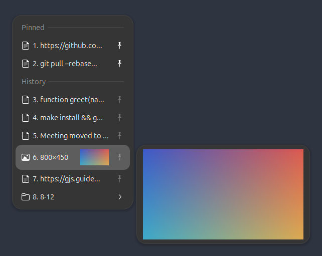
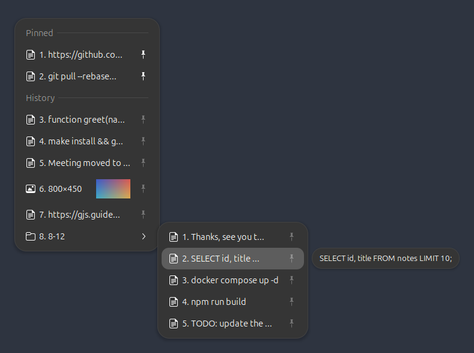

# gclipy

Clipboard history and snippet menus for GNOME Shell, inspired by the macOS app
[Clipy](https://github.com/Clipy/Clipy). It runs as a GNOME Shell extension
because only code inside the shell can watch the clipboard, register global
shortcuts and paste into other windows on Wayland.


Tested on GNOME Shell 46. `metadata.json` also lists 45, 47 and 48, which share
the same extension API, but those versions are untested.

## Features

- **History** of text and images, newest first, with Clipy's duplicate handling
  (record or ignore duplicates, move a re-copied item to the top). Items start
  with a text or image icon; without icons (Settings → Menu → "Show icons")
  images are titled "(Image)".
- **Images** (screenshots, "Copy Image" in browsers, image editors) are listed
  with their size and a thumbnail, previewed up to 320×240 when highlighted,
  and pasted back as PNG. When a copy offers both text and an image, as
  spreadsheets and office apps do, the text is recorded.
- **Preview**: the highlighted item's text (a configurable number of lines) or
  image appears in a panel beside the menu.
- **Menu layout**, after Clipy:
  - pinned items first, then snippets, then history (snippets can move after
    History in settings)
  - the 5 most recent items shown directly in the menu (configurable)
  - older history grouped into folders that open beside the menu as soon as
    they are selected or hovered; a folder's title gives the positions of its
    items in the whole list ("8. 8-17")
- **Labels and shortcut keys**: entries are labelled in keyboard order, 1–9,
  then 0 for the tenth, then A–Z, counting continuously from pinned items
  through history. A folder counts as one entry, and its items are labelled
  from 1 again. Press a label to paste that entry; a folder's label steps into
  it, so "8" then "1" pastes the first item of folder 8.
- **Pinned items** stay in a "Pinned" section and survive Clear History,
  periodic clearing and the history size limit. Pin with the pin icon or
  Ctrl+P, and rearrange with Ctrl+Up / Ctrl+Down (or optional ▲/▼ buttons,
  Settings → Menu).
- **Editing**: Ctrl+E opens a small editor for a text item. The item keeps its
  place and pin; the clipboard is not changed.
- **Pasting**: selecting an item copies it and pastes it into the focused
  window. Terminals get Ctrl+Shift+V and everything else gets Ctrl+V. Optional
  modifiers delete an item on selection, or paste it and then delete it.
- **Snippet folders**, edited as JSON in your text editor (see below). Pasted
  snippets are not added to history.
- **Privacy**: excluded applications, and skipping of content that password
  managers mark as secret (`x-kde-passwordManagerHint`).
- **Clearing** history manually (with confirmation), periodically, or when the
  extension is disabled.

Not in this version: a graphical snippet editor, and importing Clipy snippet
exports.

## Screenshots

An image item highlighted: the picture is shown in the preview panel.



An older-items folder open beside the menu. Its items are labelled from 1, so
"8" then "2" pastes the highlighted one.



## Shortcuts

Clipy's ⌘ maps to Super:

| Action | Default |
| --- | --- |
| Main menu | Shift+Super+V |
| History | Ctrl+Super+V |
| Snippets | Shift+Super+B |
| Settings | Ctrl+Alt+Shift+Super+V |

Change them on the **Shortcuts** page in settings.

Inside an open menu:

| Key | Action |
| --- | --- |
| Up / Down | Move between entries |
| Enter, click | Paste the item, or step into a folder |
| Right / Left | Step into / back out of a folder (swapped when it opens on the left) |
| 1–9, 0, A–Z | Paste the entry with that label, or step into that folder |
| Ctrl+P | Pin or unpin the item |
| Ctrl+Up / Ctrl+Down | Move a pinned item |
| Ctrl+E | Edit a text item (Enter: new line, Ctrl+Enter: save, Escape: cancel) |
| Delete | Remove the item; the menu stays open |
| Escape | Close the menu |

The keypad works with NumLock on. On layouts whose number row types letters
(Lithuanian, French…) or whose letters are not Latin (Russian, Greek…), the
label keys work by position. Turn them off under Settings → General → Paste.

## Install

```sh
make install
```

On X11, restart GNOME Shell with Alt+F2, `r`, Enter. On Wayland, log out and
back in. Then enable it:

```sh
gnome-extensions enable gclipy@gobaz.github.io
```

On X11, `make enable` does all of this: it installs, restarts GNOME Shell (by
typing Alt+F2 `r` with `xdotool` if installed, otherwise it asks you to) and
enables the extension once the shell is back.

`make pack` builds an installable zip in `dist/`.

If `clipboard-indicator` or another clipboard manager is enabled, both will
record history. Disable one of them to avoid duplicate menus and shortcuts.

## Snippets

**Edit Snippets** opens `snippets.json` in your default text editor (the app set
for plain text files, not the one for JSON, which is often a browser). The menu
reloads when you save it. If the file is invalid, you get a notification and the
previous snippets stay in the menu. `title` defaults to the content and
`enabled` defaults to `true`.

```json
{
  "folders": [
    {
      "title": "Work",
      "snippets": [
        {"title": "Signature", "content": "Best regards,\nName"},
        {"content": "https://example.com", "enabled": false}
      ]
    }
  ]
}
```

History is stored in `~/.local/share/gclipy/history.json`. Images are kept
next to it in `images/` as `<sha256>.png` plus a `.thumb.png` for the menu. They
are deleted once no history entry refers to them, and copies larger than 32 MiB
are skipped. If `history.json`
becomes unreadable, gclipy renames it to `history.json.corrupt-<time>` and
starts a new history.

## Privacy

Everything stays on your computer: gclipy makes no network connections and
keeps history only in `~/.local/share/gclipy`. Content that password managers
mark as secret is never recorded (Settings → General), and you can exclude
applications or clear history periodically or when the extension is disabled.

## Publishing to extensions.gnome.org

1. Run `make test` and `make smoke`, bump `version-name` in `metadata.json`,
   and run `make pack`.
2. Log in at <https://extensions.gnome.org> and upload
   `dist/gclipy@gobaz.github.io.shell-extension.zip` at
   <https://extensions.gnome.org/upload/>.
3. Wait for the manual review (see the
   [review guidelines](https://gjs.guide/extensions/review-guidelines/review-guidelines.html)).
   Updates are uploaded the same way with the same UUID; each one is reviewed
   again.

Only list GNOME versions in `shell-version` that you have tested.

## Development

```
lib/      pure logic (history rules, menu layout, titles, storage); imports only GLib/Gio
shell/    GNOME Shell code: clipboard monitor, menus, paste, shortcuts
tests/    unit tests for lib/, plus a headless shell smoke test
```

- `make test` runs the `lib/` unit tests with `gjs -m`. No shell is needed.
- `make smoke` (`tests/smoke.sh`) starts a headless GNOME Shell with its own
  D-Bus session, dconf database and data directories. It loads gclipy plus the
  `tests/smoke` extension, which copies text, opens the menus, selects items,
  toggles settings, and disables and re-enables gclipy. It does not touch
  your running session.
  - `SMOKE_SCREENSHOT=/path.png make smoke` also saves a screenshot with the
    prefs window open, and `SMOKE_MENU_SCREENSHOT=/path.png` one of the history
    menu with image thumbnails.
  - `KEEP_LOG=1` keeps the shell log.
- `make screenshot` regenerates the README images in `docs/` (`screenshot.png`,
  `image-preview.png`, `folder.png`) in the same headless shell, using the demo
  content in `tests/screenshot/extension.js`.
- Watch logs from the real session with `journalctl -f /usr/bin/gnome-shell`.

## License

MIT. See [LICENSE](LICENSE).
