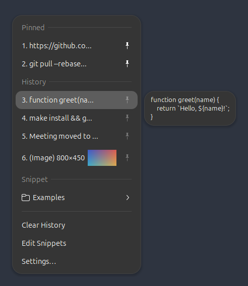

# gclipy

Clipboard history and snippet menus for GNOME Shell, inspired by the macOS app
[Clipy](https://github.com/Clipy/Clipy). It runs as a GNOME Shell extension
because only code inside the shell can watch the clipboard, register global
shortcuts and paste into other windows on Wayland.



Tested on GNOME Shell 46. `metadata.json` also lists 45, 47 and 48, which share
the same extension API, but those versions are untested.

## Features

- Clipboard history of text and images, newest first, with Clipy's duplicate
  handling (record or ignore duplicates, move a re-copied item to the top).
- History items start with a text or image icon (Settings → Menu → "Show
  icons"; without icons, images are titled "(Image)").
- Images (screenshots, "Copy Image" in browsers, image editors) are listed with
  their size (W×H) and a thumbnail, previewed larger (up to 320×240) in
  the side panel when highlighted, and are pasted back as PNG. When a copy offers
  both text and an image, as spreadsheets and office apps do, the text is
  recorded.
- Snippet folders, read from `~/.local/share/gclipy/snippets.json`.
- Clipy's menu layout:
  - numbered items, counting continuously from pinned items through history,
    with older history grouped into "6 - 15", "16 - 25"… submenus
  - the 5 most recent items shown directly in the menu (configurable)
  - in the main menu: Pinned, then Snippet, then History (snippets can be moved
    after History in settings)
  - folders (history ranges and snippet folders) show their contents beside
    the menu as soon as they are selected with the keyboard (or hovered);
    Right, Enter or a click moves into them, Left goes back. When the panel
    opens on the left near the screen edge, the arrows swap.
- Pinned items: click the pin icon on a history item, or press Ctrl+P while it
  is highlighted, to keep it in a "Pinned" section above History. Pins are
  never removed by Clear History, periodic clearing or the history size limit.
  Click the pin again to unpin, or delete the item with the delete modifier.
  Rearrange pinned items with Ctrl+Up / Ctrl+Down on the highlighted item, or
  turn on ▲/▼ buttons under Settings → Menu → "Show ▲/▼ buttons on pinned items".
- Number keys: while a menu is open, press 1–9 to paste item 1–9, or 0 for
  item 10, including items inside folders. The keypad works with NumLock on. On
  layouts whose number row types letters (Lithuanian, French…) the keys still
  work by position. You can turn this off under Settings → General → Paste.
- Selecting an item copies it and pastes it into the focused window. Terminals
  get Ctrl+Shift+V and everything else gets Ctrl+V.
- Press Delete on a highlighted history item (pinned or not) to remove it; the
  menu stays open. Optional modifiers can also delete an item on selection, or
  paste it and then delete it.
- Excluded applications, and skipping of content that password managers mark
  as secret (`x-kde-passwordManagerHint`).
- Clearing history manually (with confirmation), periodically, or when the
  extension is disabled.

Not in this version: a graphical snippet editor, and importing Clipy snippet
exports.

## Shortcuts

Clipy's ⌘ maps to Super:

| Action | Default |
| --- | --- |
| Main menu | Shift+Super+V |
| History | Ctrl+Super+V |
| Snippets | Shift+Super+B |
| Settings | Ctrl+Alt+Shift+Super+V |

Change them on the **Shortcuts** page in settings.

## Install

```sh
make install
```

On X11, restart GNOME Shell with Alt+F2, `r`, Enter. On Wayland, log out and
back in. Then enable it:

```sh
gnome-extensions enable gclipy@gobaz.github.io
```

On X11, `make enable` does all of this: it installs, restarts GNOME Shell (by
typing Alt+F2 `r` with `xdotool` if installed, otherwise it asks you to) and
enables the extension once the shell is back.

`make pack` builds an installable zip in `dist/`.

If `clipboard-indicator` or another clipboard manager is enabled, both will
record history. Disable one of them to avoid duplicate menus and shortcuts.

## Snippets

**Edit Snippets** opens `snippets.json` in your default text editor (the app set
for plain text files, not the one for JSON, which is often a browser). The menu
reloads when you save it. If the file is invalid, you get a notification and the
previous snippets stay in the menu. `title` defaults to the content and
`enabled` defaults to `true`.

```json
{
  "folders": [
    {
      "title": "Work",
      "snippets": [
        {"title": "Signature", "content": "Best regards,\nName"},
        {"content": "https://example.com", "enabled": false}
      ]
    }
  ]
}
```

History is stored in `~/.local/share/gclipy/history.json`. Images are kept
next to it in `images/` as `<sha256>.png` plus a `.thumb.png` for the menu. They
are deleted once no history entry refers to them, and copies larger than 32 MiB
are skipped. If `history.json`
becomes unreadable, gclipy renames it to `history.json.corrupt-<time>` and
starts a new history.

## Privacy

Everything stays on your computer: gclipy makes no network connections and
keeps history only in `~/.local/share/gclipy`. Content that password managers
mark as secret is never recorded (Settings → General), and you can exclude
applications or clear history periodically or when the extension is disabled.

## Publishing to extensions.gnome.org

1. Run `make test` and `make smoke`, bump `version-name` in `metadata.json`,
   and run `make pack`.
2. Log in at <https://extensions.gnome.org> and upload
   `dist/gclipy@gobaz.github.io.shell-extension.zip` at
   <https://extensions.gnome.org/upload/>.
3. Wait for the manual review (see the
   [review guidelines](https://gjs.guide/extensions/review-guidelines/review-guidelines.html)).
   Updates are uploaded the same way with the same UUID; each one is reviewed
   again.

Only list GNOME versions in `shell-version` that you have tested.

## Development

```
lib/      pure logic (history rules, menu layout, titles, storage); imports only GLib/Gio
shell/    GNOME Shell code: clipboard monitor, menus, paste, shortcuts
tests/    unit tests for lib/, plus a headless shell smoke test
```

- `make test` runs the `lib/` unit tests with `gjs -m`. No shell is needed.
- `make smoke` (`tests/smoke.sh`) starts a headless GNOME Shell with its own
  D-Bus session, dconf database and data directories. It loads gclipy plus the
  `tests/smoke` extension, which copies text, opens the menus, selects items,
  toggles settings, and disables and re-enables gclipy. It does not touch
  your running session.
  - `SMOKE_SCREENSHOT=/path.png make smoke` also saves a screenshot with the
    prefs window open, and `SMOKE_MENU_SCREENSHOT=/path.png` one of the history
    menu with image thumbnails.
  - `KEEP_LOG=1` keeps the shell log.
- `make screenshot` regenerates `docs/screenshot.png` in the same headless shell, using the demo
  content in `tests/screenshot/extension.js`.
- Watch logs from the real session with `journalctl -f /usr/bin/gnome-shell`.

## License

MIT. See [LICENSE](LICENSE).
